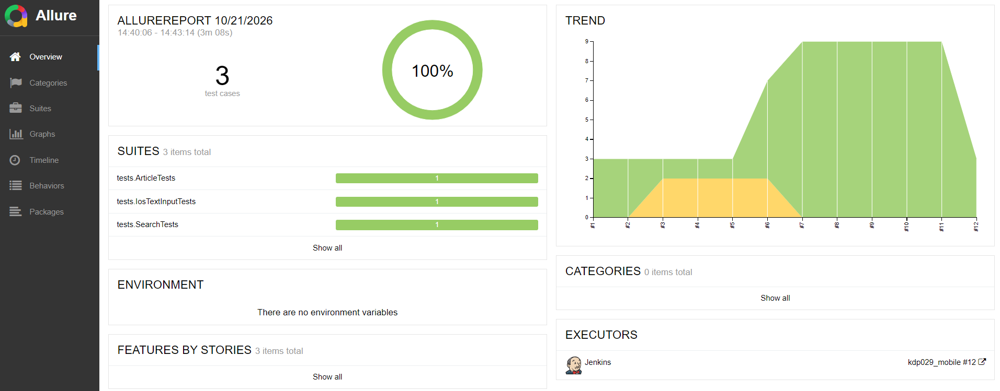
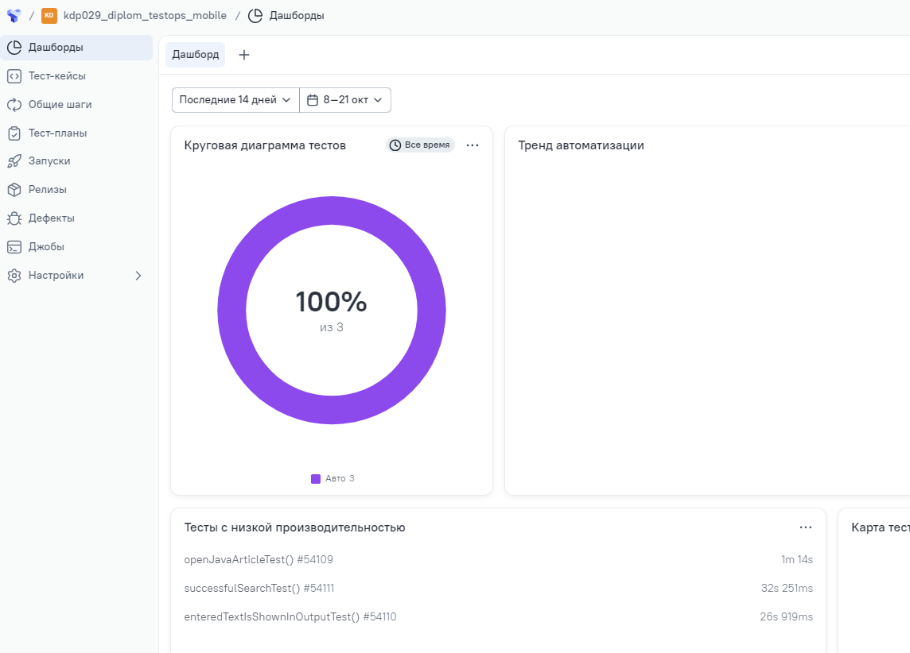
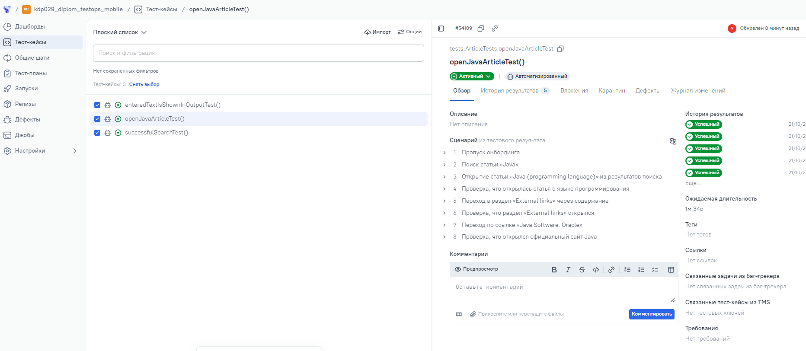
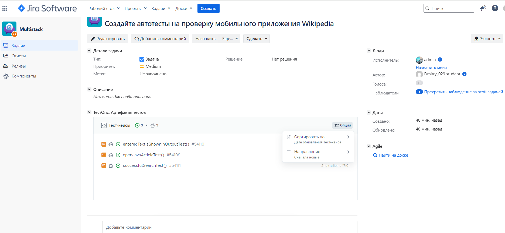
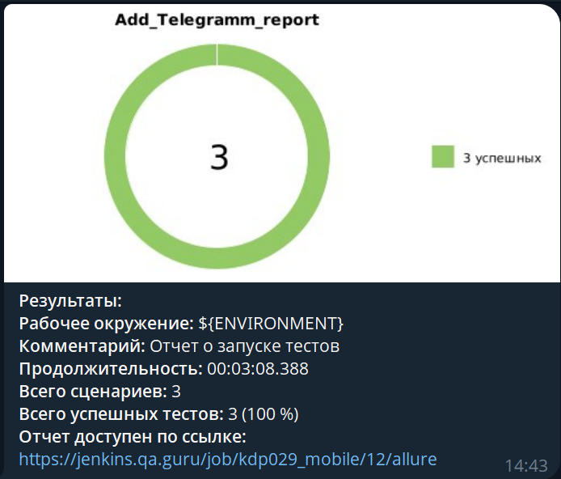

<a id="readme-top"></a>
<h1>Проект по автоматизации тестирования мобильного приложения Wikipedia</h1>

Автотесты мобильного приложения [Wikipedia](https://www.wikipedia.org/) для Android
и демо-приложения BrowserStack Sample для iOS. Один и тот же набор Android-тестов
запускается на трёх стендах: облако BrowserStack, эмулятор и телефон по USB.
Стенд выбирается ключом `-DdeviceHost`, тесты при этом не меняются.

## ☑️ Содержание:

- [Технологии и инструменты](#tools)
- [Список проверок, реализованных в тестах](#cases)
- [Запуск тестов из терминала](#run)
- [Сборка в Jenkins](#jenkins)
- [Allure-отчёт](#allure)
- [Интеграция с Allure TestOps](#testops)
- [Интеграция с Jira](#jira)
- [Уведомление в Telegram](#telegram)
- [Подробная документация](#docs)

<a id="tools"></a>
## :ballot_box_with_check: Технологии и инструменты:

| Java | IntelliJ IDEA | GitHub | JUnit 5 | Gradle | Selenide | Allure | Jenkins |
|:----:|:-------------:|:------:|:-------:|:------:|:--------:|:------:|:-------:|
| <a href="https://www.java.com/"></a> | <a href="https://www.jetbrains.com/idea/"></a> | <a href="https://github.com/"></a> | <a href="https://junit.org/junit5/"></a> | <a href="https://gradle.org/"></a> | <a href="https://selenide.org/"></a> | <a href="https://github.com/allure-framework"></a> | <a href="https://www.jenkins.io/"></a> |

Тесты написаны на языке <code>Java</code>, сборщик — <code>Gradle</code> 8.13,
фреймворк модульного тестирования — <code>JUnit 5</code>. Мобильные сессии
создаёт [Appium](https://appium.io/) (java-client), шаги и проверки —
[Selenide](https://selenide.org/). Настройки стендов читает
[Owner](http://owner.aeonbits.org/): значения из командной строки и переменных
окружения важнее файлов в <code>src/test/resources</code>. Отчёт — <code>Allure</code>.

Устройства:

- [BrowserStack App Automate](https://www.browserstack.com/app-automate) — стенд по умолчанию, Android и iOS;
- эмулятор Android на своей машине;
- телефон Android, подключённый по USB.

<p align="right"><a href="#readme-top">back to top</a></p>

<a id="cases"></a>
## :ballot_box_with_check: Реализованные проверки:

- `SearchTests` — после онбординга поиск «Appium» в Wikipedia возвращает хотя бы одну статью;
- `ArticleTests` — по запросу «Java» открывается статья «Java (programming language)»,
  из раздела «External links» выполняется переход по ссылке «Java Software, Oracle»
  на `oracle.com/java`;
- `IosTextInputTests` — в демо-приложении Sample iOS введённый текст появляется
  в поле Text Output. Тест идёт только в BrowserStack: локального стенда для iOS нет,
  на `emulation` и `real` он пропускается.

Android-тесты работают со стабильной сборкой Wikipedia
`2.7.50450-r-2023-08-15` (пакет `org.wikipedia`). В BrowserStack загружена та же
сборка под `custom_id` `WikipediaStable27`, поэтому облако и локальные стенды
проверяют одно и то же приложение. Локаторы опираются на `resource-id`, а не на
переведённый `content-desc`.

<p align="right"><a href="#readme-top">back to top</a></p>

<a id="run"></a>
## :ballot_box_with_check: Запуск тестов из терминала

По умолчанию стенд — BrowserStack. Логин и ключ берутся из
`src/test/resources/auth.properties` либо из переменных
`BROWSERSTACK_USERNAME` и `BROWSERSTACK_ACCESS_KEY`.

```sh
./gradlew clean test
./gradlew test -DdeviceHost=browserstack
./gradlew test -DdeviceHost=emulation
./gradlew test -DdeviceHost=real
```

Устройство и отдельные настройки переопределяются тем же `-D`, файлы менять не нужно:

```sh
./gradlew test -DdeviceHost=browserstack -DBROWSERSTACK_ANDROID_DEVICE="Google Pixel 9"
./gradlew test -DdeviceHost=emulation -DEMULATION_AVD=Pixel_10a
./gradlew test -DdeviceHost=real -DREAL_DEVICE_UDID=R58R611HJWD
./gradlew test --tests tests.SearchTests
./gradlew test --tests tests.IosTextInputTests
```

| Стенд | Что нужно на машине | Приложение |
| --- | --- | --- |
| `browserstack` | доступ к хабу BrowserStack | `WikipediaStable27`, устройство из `browserstack.properties` (Samsung Galaxy S23, Android 13.0) |
| `emulation` | Appium и Android SDK, имя AVD в `EMULATION_AVD` | APK с `releases.wikimedia.org`, адрес сервера — `LOCAL_APPIUM_URL` |
| `real` | Appium, телефон в `adb devices` | тот же APK |

Для локальных стендов сервер поднимается так, чтобы адрес совпал с
`LOCAL_APPIUM_URL` (`http://localhost:4723/wd/hub`):

```sh
appium --base-path /wd/hub
```

iOS в облаке: приложение `BStackSampleApp`, iPhone 14, iOS 16.
Язык Android-устройства задан явно (`en` / `US`): от него зависит текст статьи в `ArticleTests`.

<p align="right"><a href="#readme-top">back to top</a></p>

<a id="jenkins"></a>
##  Сборка в Jenkins

В корне лежит `Jenkinsfile`. Джоба берёт код из этого репозитория и запускает
`./gradlew clean test`. На агенте нужны JDK и выход в сеть до BrowserStack и
`services.gradle.org`. Appium и эмулятор на агенте не нужны: стенд по умолчанию —
`browserstack`.

### Параметры сборки

- `TESTS` — фильтр Gradle, пустое значение запускает весь набор (например `tests.Article*`);
- `BROWSERSTACK_ANDROID_DEVICE` — Android-устройство (по умолчанию `Samsung Galaxy S23`);
- `BROWSERSTACK_ANDROID_OS_VERSION` — версия Android (по умолчанию `13.0`);
- `BROWSERSTACK_IOS_DEVICE` — iOS-устройство (по умолчанию `iPhone 14`);
- `BROWSERSTACK_IOS_OS_VERSION` — версия iOS (по умолчанию `16`).

Имена параметров совпадают с ключами Owner, поэтому Jenkins отдаёт их в тесты
как переменные окружения. Отчёт Allure публикуется в `post { always }` из
`build/allure-results`.

Логин и ключ BrowserStack можно не хранить в репозитории: те же имена
`BROWSERSTACK_USERNAME` и `BROWSERSTACK_ACCESS_KEY` читаются из credentials джоба
и перебивают `auth.properties`.

Прогон публикуется джобой
[kdp029_mobile](https://jenkins.qa.guru/job/kdp029_mobile/).
В Allure-отчёте сборки — 3 сценария (`ArticleTests`, `IosTextInputTests`,
`SearchTests`), исполнитель — Jenkins.

<p align="center">

</p>

<p align="right"><a href="#readme-top">back to top</a></p>

<a id="allure"></a>
##  Allure-отчёт

После прогона отчёт собирается плагином Allure:

```sh
./gradlew test
./gradlew allureServe
# либо статический отчёт
./gradlew allureReport
```

В отчёт Allure попадают шаги теста, последний скриншот и page source.
Для сессий BrowserStack дополнительно прикладывается видео. При падении
Selenide сохраняет скриншот и page source ещё и в HTML-отчёт Gradle:
`build/reports/tests/test/index.html`.

Опубликованный отчёт прогона — в разделе [Jenkins](#jenkins).

<p align="right"><a href="#readme-top">back to top</a></p>

<a id="testops"></a>
## :ballot_box_with_check: Интеграция с Allure TestOps

Прогоны загружаются в проект Allure TestOps `kdp029_diplom_testops_mobile`.
На дашборде — 3 автоматизированных теста (100%): поиск статьи, статья о Java
и ввод текста в iOS-приложении.

### Дашборд

<p align="center">

</p>

### Тест-кейсы

<p align="center">

</p>

<p align="right"><a href="#readme-top">back to top</a></p>

<a id="jira"></a>
## :ballot_box_with_check: Интеграция с Jira

Задача «Создайте автотесты на проверку мобильного приложения Wikipedia»
связана с тест-кейсами TestOps. В блоке «ТестOps: Артефакты тестов» видны
`openJavaArticleTest`, `successfulSearchTest` и `enteredTextIsShownInOutputTest`.

<p align="center">

</p>

<p align="right"><a href="#readme-top">back to top</a></p>

<a id="telegram"></a>
## :ballot_box_with_check: Уведомление в Telegram

По завершении прогона бот присылает сводку: 3 из 3 успешных сценариев
и ссылку на Allure-отчёт Jenkins.

<p align="center">

</p>

<p align="right"><a href="#readme-top">back to top</a></p>

<a id="docs"></a>
## :ballot_box_with_check: Подробная документация

- [Стенды и выбор устройства](docs/stands.md)
- [Локальный прогон: эмулятор и телефон](docs/local-run.md)
- [Почему драйвер BrowserStack устроен так](docs/browserstack-driver.md)
- [Запуск на Jenkins](docs/jenkins.md)

<p align="right"><a href="#readme-top">back to top</a></p>
